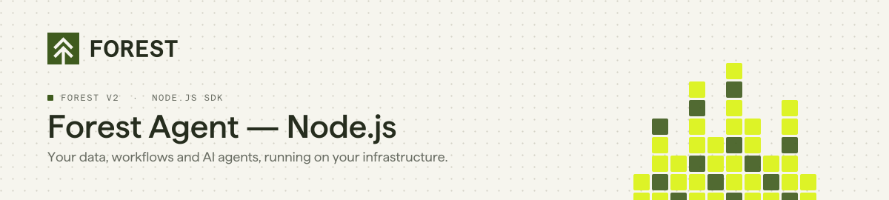
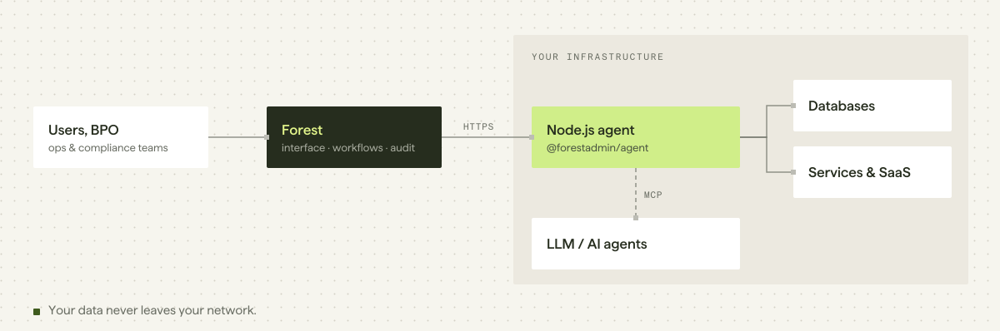

<p align="center">
  <picture>
    <source media="(prefers-color-scheme: dark)" srcset="./assets/header-agent-nodejs-dark.svg">
    
  </picture>
</p>

<p align="center">
  <a href="https://www.npmjs.com/package/@forestadmin/agent"></a>
  <a href="https://github.com/ForestAdmin/agent-nodejs/actions/workflows/build.yml"></a>
  <a href="./LICENSE"></a>
</p>

**Forest is the back office for operations teams in regulated companies.** Ops teams review, decide and act on your data from one interface, or let AI agents do it through MCP, within the roles, permissions and audit logs you define.

This repository is the **Node.js agent**: the part of Forest that runs on your servers, connects to your databases and services, and exposes them to the Forest interface and to AI agents. Your business data never goes through Forest.

> [!NOTE]
> **Forest v2.** This is the current Node.js SDK. Using `forest-express-sequelize` or `forest-express-mongoose`? You are on v1: see the [migration guide](https://docs.forest.app/guides/migration/from-v1/overview).

## Quick start

```bash
npm install @forestadmin/agent @forestadmin/datasource-sql
```

```typescript
import { createAgent } from '@forestadmin/agent';
import { createSqlDataSource } from '@forestadmin/datasource-sql';

const agent = createAgent({
  authSecret: process.env.FOREST_AUTH_SECRET,
  envSecret: process.env.FOREST_ENV_SECRET,
  isProduction: process.env.NODE_ENV === 'production',
});

agent.addDataSource(createSqlDataSource(process.env.DATABASE_URL));

await agent.start();
```

Required environment variables: `FOREST_ENV_SECRET`, `FOREST_AUTH_SECRET`, `DATABASE_URL`.
Full guide: [docs.forest.app/get-started/quickstart](https://docs.forest.app/get-started/quickstart)

## Requirements

| | |
|---|---|
| Node.js | Developed and tested on Node.js 24 (see [`.nvmrc`](./.nvmrc)) |
| Framework | None required: standalone server, or mounted on Express, Koa, Fastify or NestJS |

## What the agent gives you

| | |
|---|---|
| **Data** | Connect your databases and services through data sources: SQL, Sequelize, Mongoose, MongoDB, Zendesk, replicas, RPC. |
| **Customization** | Computed fields, actions, segments, hooks and validations in TypeScript, with autocompletion generated from your schema. |
| **Workflows** | Runs your Forest business processes on your side (`@forestadmin/workflow-executor`). |
| **MCP server** | Exposes your collections and actions to AI agents through the Model Context Protocol (`@forestadmin/mcp-server`). |
| **Permissions and audit** | Roles, scopes and activity logs defined in Forest, enforced on every request, from the UI or from an AI agent. |

## How it works

<picture>
  <source media="(prefers-color-scheme: dark)" srcset="./assets/arch-agent-nodejs-dark.svg">
  
</picture>

The agent runs **on your infrastructure**. The Forest interface calls your agent, and your agent queries your sources: Forest does not store your business data. You control what is exposed, to whom, and the logic applied to it.

## Documentation

| | |
|---|---|
| Get started | https://docs.forest.app/get-started/quickstart |
| Connect a data source | https://docs.forest.app/get-started/connect/data-sources/overview |
| Node.js API reference | https://docs.forest.app/reference/agent-api/nodejs |
| MCP server | https://docs.forest.app/product/embed/mcp-server |
| Migrating from v1 | https://docs.forest.app/guides/migration/from-v1/overview |

<details>
<summary><b>Packages in this monorepo</b></summary>

`@forestadmin/agent` · `datasource-sql` · `datasource-sequelize` · `datasource-mongoose` · `datasource-mongo` · `datasource-zendesk` · `datasource-replica` · `datasource-customizer` · `mcp-server` · `workflow-executor` · `agent-testing` · `plugin-aws-s3` · `plugin-flattener` · `plugin-export-advanced` · `forest-cloud`

Experimental plugins and data sources: [forestadmin-experimental](https://github.com/ForestAdmin/forestadmin-experimental).

</details>

## Contributing

Bug reports and pull requests are welcome. See [CONTRIBUTING.md](./CONTRIBUTING.md) for setup, tests and commit conventions.

```bash
yarn install && yarn build && yarn test
```

## License

Apache 2.0. See [LICENSE](./LICENSE).
